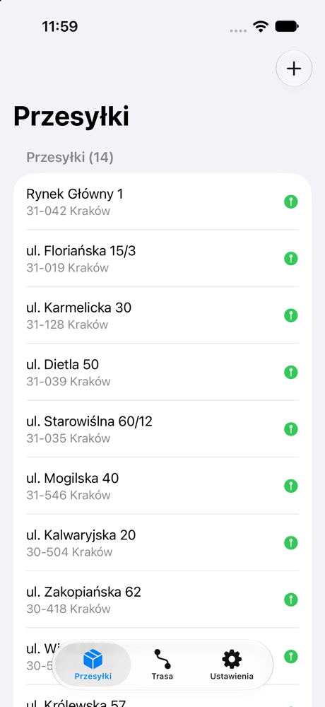
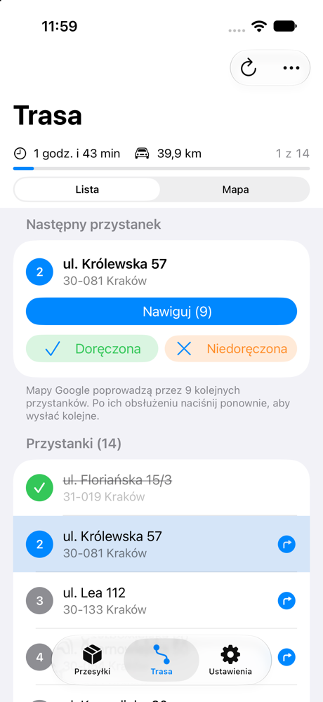
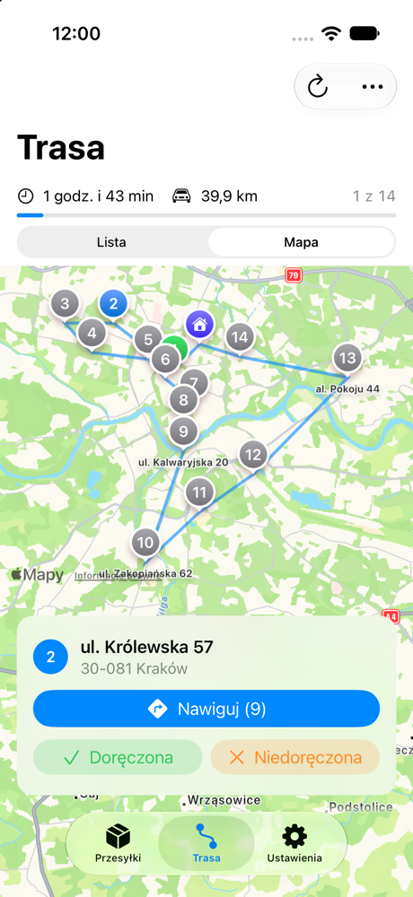
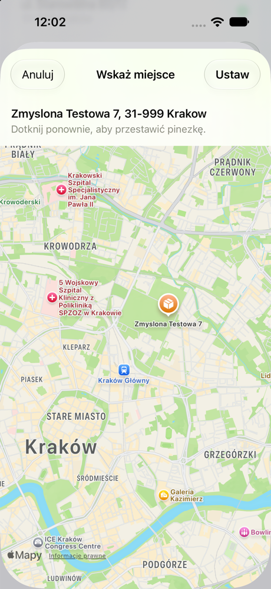

# Pathly

Natywna aplikacja iOS dla kuriera. Kurier robi zdjęcie listu przewozowego, aplikacja odczytuje z niego **adres doręczenia**, ustala jego położenie, a po zebraniu przesyłek wylicza najszybszą kolejność doręczeń — od bazy do bazy — na rzeczywistych czasach przejazdu.

Projekt edukacyjny i portfolio: SwiftUI, Swift 6 (strict concurrency), SwiftData, Vision, MapKit i własna implementacja heurystyk dla asymetrycznego problemu komiwojażera.

<p>
  
  
  
  
</p>

## Funkcje

- **Adres ze zdjęcia etykiety.** OCR (Vision, `pl-PL`) i parser, który wybiera blok odbiorcy, a odrzuca nadawcę, kody kreskowe, wagi i numery przesyłek. Kurier zawsze sprawdza i zatwierdza adres — nic nie zapisuje się samo. Można też wpisać adres ręcznie.
- **Geokodowanie w tle.** Kolejka `MKGeocodingRequest` — sekwencyjnie, z ponawianiem po limicie zapytań, bez ponownego geokodowania znanych adresów. Gdy mapa nie zna adresu, kurier poprawia go, wybiera jedno z pasujących miejsc albo wskazuje budynek na mapie.
- **Macierz czasów przejazdu z OpenRouteService** dzielona na bloki w limitach darmowego planu, z pamięcią podręczną. Bez klucza, sieci albo limitu — przybliżenie z odległości, wyraźnie oznaczone w interfejsie.
- **Optymalizacja trasy** dla ponad 100 przystanków poniżej sekundy (szczegóły niżej).
- **Realizacja trasy:** lista i mapa z ponumerowanymi przystankami, bieżący przystanek, statusy doręczony / niedoręczony, nawigacja w Mapach Google (partiami do 9 przystanków) albo w Mapach Apple, „Zakończ dzień”.
- Trasa oznacza się jako **nieaktualna**, gdy przesyłki zmienią się po jej wyliczeniu.

## Architektura

MVVM z warstwą serwisów. Widoki SwiftUI nie zawierają logiki biznesowej; view modele (`@Observable`) dostają zależności przez protokoły, więc da się je testować bez interfejsu i podmieniać implementacje (podglądy, testy, tryb bez klucza API).

```
pathly/
  App/               korzeń kompozycji (AppDependencies), dane pokazowe (DEBUG)
  Features/          ekrany i view modele: Base, Capture, Parcels, Route, Settings, Shared
  Domain/
    Models/          Address, Coordinate, CostMatrix, statusy
    AddressParsing/  parser adresu doręczenia — czysty Swift, bez Vision
    RouteOptimization/  algorytm trasy — czysty Swift, bez UI, MapKit i sieci
  Services/
    TextRecognition/ Vision
    Geocoding/       MapKit + kolejka geokodowania
    TravelCost/      OpenRouteService, haversine, pamięć podręczna, limity
    RoutePlanning/   punkty → macierz → optymalizacja → kolejność przesyłek
    Navigation/      linki do Map Apple i Map Google
  Persistence/       modele i magazyny SwiftData (dane wyłącznie lokalne)
Tests/               testy jednostkowe (Swift Testing)
Tools/               generatory przykładowych etykiet i ikony
```

Kilka decyzji:

- **Domyślna izolacja `MainActor`** (Swift 6.2+) dla aplikacji; typy domenowe i serwisy są `nonisolated`, a ciężkie obliczenia (`RouteOptimizer.optimize`) są `@concurrent` — liczą się poza głównym wątkiem.
- **Widoki czytają dane przez `@Query`**, a wszystkie zmiany przechodzą przez protokoły magazynów (`ParcelStore`, `DeliveryStore`, `RouteStore`). Unieważnienie trasy dzieje się w tym samym zapisie co zmiana przesyłki, więc nie da się o nim zapomnieć.
- **`TravelCostProvider`** to jedyne, co algorytm wie o czasach przejazdu. `FallbackCostProvider` łączy pamięć podręczną, OpenRouteService i przybliżenie haversine.

## Algorytm trasy

Problem to **asymetryczny problem komiwojażera** (ATSP) ze startem i końcem w bazie: czas A → B bywa inny niż B → A (ulice jednokierunkowe, skręty). Dokładne rozwiązanie dla 100+ punktów jest niewykonalne, więc:

1. **Konstrukcja — najbliższy sąsiad** z bazy, O(n²).
2. **Przeszukiwanie lokalne** na przemian, aż żaden ruch nie skraca trasy:
   - **Or-opt** — przeniesienie segmentu 1–3 przystanków bez odwracania. Zmiana kosztu to 3 usunięte i 3 dodane krawędzie, liczone w O(1). Miejsca wstawienia są ograniczone do **list 12 najbliższych sąsiadów** (poprzedników i następników) — kilkukrotnie mniej pracy przy tej samej jakości.
   - **2-opt** — odwrócenie segmentu. W macierzy asymetrycznej odwrócony segment jedzie każdą krawędzią w drugą stronę, więc jego koszt trzeba przeliczyć w całości; robimy to dokładnie w O(1) dzięki **sumom prefiksowym** kosztów „w przód” i „w tył”.
3. **Multi-start** — 30 restartów: najlepsza trasa jest zaburzana ruchem *double bridge* (zamiana dwóch fragmentów bez odwracania) i ponownie poprawiana. Stałe ziarno daje powtarzalne wyniki.

Obliczenia działają w tle, z obsługą anulowania i limitem 2 s (po nim zwracana jest najlepsza dotąd trasa).

**Wyniki** (testy w buildzie Debug na symulatorze):

| Pomiar | Wynik |
|---|---|
| 150 punktów — czas procesora | 0,54–0,62 s (kryterium: < 2 s) |
| Poprawa względem samego najbliższego sąsiada | 9–26 % |
| Do 4 przystanków vs brute force | zawsze optimum |
| 5–6 przystanków | optimum w 30/30 losowych przypadków |
| 7 przystanków | optimum w 29/30, najgorzej +3,1 % |

## Macierz OpenRouteService

Endpoint `POST /v2/matrix/driving-car` (czas i dystans). Ograniczenia darmowego planu i jak są obsłużone:

- **3500 par na zapytanie** — macierz N × N jest dzielona na bloki wierszy (np. 101 punktów → 3 zapytania po 34, 34 i 33 źródła × 101 celów) i składana w jedną.
- **40 zapytań na minutę, 500 dziennie** — `RequestRateLimiter` z oknem przesuwnym i dziennym licznikiem zapisywanym na urządzeniu; po HTTP 429 ponowienie z opóźnieniem.
- **Pamięć podręczna** ostatnich macierzy dla tego samego zestawu punktów — ponowne przeliczenie bez zmian nie zużywa limitu.
- **Przybliżenie** (haversine × 1,3 na objazdy, 35 km/h) przy braku klucza, sieci, wyczerpanym limicie lub błędzie usługi; aplikacja pokazuje powód.

## Uruchomienie

Wymagania: Xcode 27, iOS 26+. Bez zależności zewnętrznych (SPM).

1. Klucz API (opcjonalny — bez niego trasa liczy się w trybie przybliżonym). Załóż darmowe konto na openrouteservice.org i:

   ```bash
   cp Config/Secrets.example.xcconfig Config/Secrets.xcconfig
   ```

   Wpisz klucz w `Config/Secrets.xcconfig` (`ORS_API_KEY = …`). Plik jest w `.gitignore`; klucz trafia do aplikacji przez `Info.plist` (`ORSAPIKey`).

2. Otwórz `pathly.xcodeproj` i uruchom schemat `pathly`.

3. Testy:

   ```bash
   xcodebuild test -scheme pathly -destination 'platform=iOS Simulator,name=iPhone 17'
   ```

   Test na żywej usłudze ORS (`OpenRouteServiceLiveTests`, 3 zapytania) uruchamia się tylko, gdy klucz jest skonfigurowany.

**Dane pokazowe** (tylko build DEBUG): uruchomienie z argumentem `-demo` startuje aplikację z bazą w pamięci i 14 fikcyjnymi przesyłkami w Krakowie — prawdziwe dane na urządzeniu zostają nietknięte.

```bash
xcrun simctl launch booted com.mikolajbozko.pathly -demo
```

Przykładowe etykiety do testów OCR w symulatorze: `swift Tools/make-sample-labels.swift`, potem `xcrun simctl addmedia booted SampleLabels/*.png`.

## Ograniczenia

- **Linia trasy na mapie to odcinki proste** między przystankami — macierz nie zawiera geometrii dróg, a dociąganie jej dla każdego odcinka przekroczyłoby limity. Dokładną drogę pokazuje nawigacja.
- **Brak nawigacji zakręt po zakręcie w aplikacji** — świadomie poza zakresem; nawigację prowadzą Mapy Google lub Apple.
- **Mapy Apple prowadzą do jednego przystanku** — nie mają udokumentowanego linku z wieloma przystankami. Mapy Google dostają partie do 9 punktów (limit z praktyki, nie z dokumentacji Google).
- **Geokoder Apple czasem zwraca położenie ulicy**, a nie budynku; wtedy można wskazać budynek na mapie.
- **Parser etykiet opiera się na heurystykach** (kotwice „Odbiorca”, „Do:”, kod pocztowy, wzorce ulic) — dla nietypowych układów kurier wybiera kandydata albo poprawia adres ręcznie.
- **Optymalizowany jest czas jazdy**; czas obsługi przystanku, okna czasowe, priorytety i pojemność auta są poza zakresem.
- **Limity darmowego ORS** (500 zapytań dziennie) wystarczają na kilkadziesiąt przeliczeń dużej trasy dziennie.
- Dane są wyłącznie lokalne — bez kont, synchronizacji i backendu.
